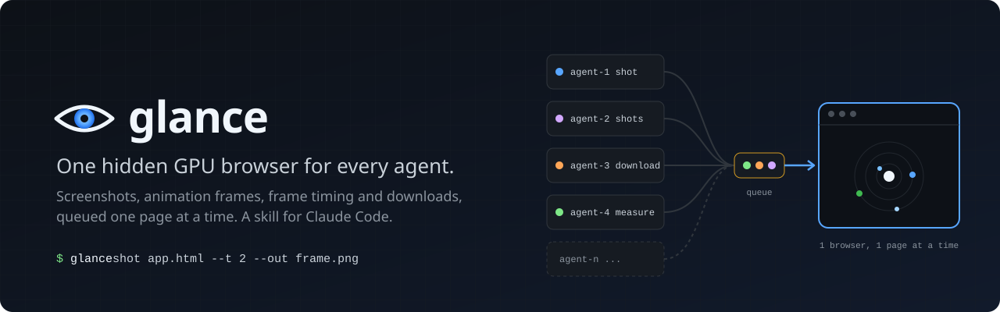

<p align="center">
  
</p>

# Glance Browser Lite

[](LICENSE)
[](https://github.com/GameOwerMedia/glance-browser-lite/actions/workflows/ci.yml)

A Claude Code skill and small Node.js CLI that gives every coding agent on a machine one shared, hidden
GPU browser. Screenshots, animation frames, frame-time statistics and downloads go through a local job
queue that runs one page at a time, so ten agents never open ten browsers. This is the minimal MIT
edition; a separate source-available edition exists.

## Install

Requires Node.js 20 or newer and Playwright's Chromium:

```bash
npm install -g playwright
playwright install chromium   # Windows PowerShell 5.1: playwright.cmd install chromium
```

As a Claude Code plugin (the skill is then `/glance:glance`):

```text
/plugin marketplace add GameOwerMedia/glance-browser-lite
/plugin install glance@glance
```

Or copy `skills/glance` to `~/.claude/skills/glance` (the skill is then `/glance`).

## Usage

Inside Claude Code the agent runs these commands for you. To run them yourself after the copy install,
define `glance` once per shell:

```bash
glance() { node "$HOME/.claude/skills/glance/scripts/glance.mjs" "$@"; }          # bash, zsh
```

```powershell
function glance { node "$HOME/.claude/skills/glance/scripts/glance.mjs" @args }   # PowerShell
```

```bash
glance shot http://localhost:3000 --out home.png                     # 960x540 screenshot
glance shot app.html --t 2.5 --width 1920 --height 1080 --out f.png  # the frame at ?t=2.5, full HD
glance shots app.html --ts '0.5,1.5,3' --out seq.png                 # seq-t0.5.png, ... (quotes needed in PowerShell)
glance measure app.html                                              # frame-time statistics over 3 s
glance download app.html --click "#export" --out-dir exports         # files the page downloads
glance status                                                        # renderer, WebGPU, queue
glance stop                                                          # stop this server and its browser
```

Every job prints one JSON object. The server starts on first use, binds to the loopback interface,
and exits after 5 idle minutes. `--t` only adds `?t=` (or `&t=`) to the URL, before any `#hash`; the page decides what it means
(see [`examples/orbit.html`](examples/orbit.html)). All options:
[cli.md](skills/glance/references/cli.md); HTTP API: [http-api.md](skills/glance/references/http-api.md);
problems: [troubleshooting.md](skills/glance/references/troubleshooting.md).

## Configuration

Environment variables, passed on by the client to the server it starts.

| Variable | Default | Meaning |
|---|---|---|
| `GLANCE_PORT` | `7333` | Port on localhost (`--port` per command). |
| `GLANCE_HOME` | `%LOCALAPPDATA%\glance`, `~/Library/Caches/glance`, `${XDG_CACHE_HOME:-~/.cache}/glance` | State file, log, default output (Windows, macOS, Linux). |
| `GLANCE_IDLE_MS` | `300000` | Exit after this long without jobs. |
| `GLANCE_JOB_TIMEOUT_MS` | `120000` | Hard limit per job. |
| `GLANCE_DOWNLOAD_TIMEOUT_MS` | `240000` | Hard limit per download job. |
| `GLANCE_GPU` | `1` | `0` drops the GPU flags (CI, containers). |
| `GLANCE_ANGLE` | `auto` | `d3d11`, `metal`, `vulkan`, `gl` or `none`. |
| `GLANCE_WEBGPU` | `1` | `0` leaves out `--enable-unsafe-webgpu`. |
| `GLANCE_BROWSER_ARGS` | none | Extra Chromium flags; `--disable-gpu-vsync` and `--disable-frame-rate-limit` are dropped. |
| `GLANCE_PLAYWRIGHT` | auto | Path to a Playwright package or its `index.mjs`. |
| `GLANCE_EXECUTABLE` | Playwright's | Path to another Chromium build. |
| `GLANCE_LOW_PRIORITY` | `1` | `0` keeps normal process priority. |
| `GLANCE_NO_SANDBOX` | unset | `1` turns the Chromium sandbox off. Trusted pages only. |
| `GLANCE_HEADLESS_SHELL` | unset | `1` uses `chromium-headless-shell` instead of full Chromium. |
| `GLANCE_LOG_MAX_BYTES` | `1048576` | Log size that triggers rotation at startup. |

## Limitations

- One page at a time by design; throughput is bounded by page load time.
- Chromium only.
- Frame times are comparable between runs on one machine, not across machines or with a user's device.
- Without a GPU (most CI runners) results carry `rendererWarning` and frame times are not representative.
- WebGPU depends on OS, driver and browser build; `glance status` shows the probe result.
- The access token protects against web pages, not against other processes of the same user. Only load
  pages you trust. See [SECURITY.md](SECURITY.md).

## Development

```bash
npm ci
npx playwright install chromium
npm test
```

Issues and pull requests are welcome; keep the two design rules: one page at a time, and no flags that
disable vsync or the frame-rate limit.

## License

[MIT](LICENSE). Playwright (Apache-2.0) is installed separately and not redistributed here.
